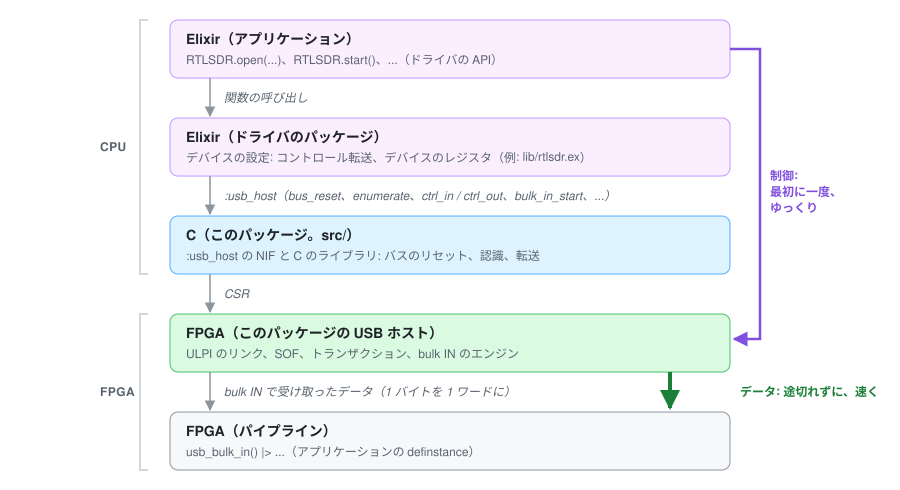

# USB ホストの上でデバイスのドライバを書く

[English](driver-guide.md) | 日本語

atomvm-tang25k-hls で作るアプリケーションから、USB のデバイスを使う方法を説明します。
ドライバは、このパッケージの `:usb_host` の関数を使って、Elixir で書きます。デバイスから
来るデータの流れは、CPU を通らずに、FPGA のパイプラインに入ります。
[atomvm-tang25k-rtlsdr](https://github.com/elixir-hls/atomvm-tang25k-rtlsdr)（`RTLSDR`）が、
すべてを備えた例です。この資料は、それに沿って説明します。

## 仕事の分け方



デバイスの設定は、コントロール転送を何度も行う作業で、時間がかかりますが、最初に一度
するだけです。これは CPU が、ドライバの Elixir のコードで受け持ちます。一方、データの
流れは速く、途切れずに続きます。ドライバが bulk IN のエンジンを動かすと、あとは FPGA が、
デバイスにデータを求め続け、受け取ったデータを 1 バイトずつ 1 ワードにして、パイプラインに
渡します。

ドライバは、このパッケージを、`:usb_host`（lib/usb_host.erl）を通してだけ使います。その下に
ある C のライブラリと、ホストの CSR は、このパッケージが決めるもので、回路が変われば
変わります。

## ドライバのパッケージ

ドライバは、Elixir のコードだけを持つパッケージです。

```
mydev/
  lib/mydev.ex          ドライバ: MyDev.open/... など。アプリケーションのパックに組み込まれる
```

アプリケーションの hls.env には、このパッケージとドライバの両方を書きます。

```sh
EHLS_BLOCKS=../atomvm-tang25k-usb-host:../mydev
```

atomvm-tang25k-hls のスクリプトが、各パッケージの lib/ を、アプリケーションのパックに
組み込みます。`:usb_host` の NIF は、SoC に USB ホストがあるとき（アプリケーションが
`EHLS.USBHost` を使うとき）に、AtomVM に入ります。

## 手順

### 1. バスのリセット

```elixir
case :usb_host.bus_reset() do
  :ok -> :ok
  {:error, _} ->
    # 電源を入れた直後は、PHY が応答しないことがある。リセットのパルスで戻る
    :usb_host.phy_reset()
    :usb_host.bus_reset()
end
```

`bus_reset/0` は、VBUS（バスの電源）を入れ、デバイスがつながるのを待ち、ハイスピードの
ハンドシェイクを含めてバスをリセットし、SOF を出し始めます。

### 2. デバイスの認識

```elixir
{:ok, addr, device_descriptor} = :usb_host.enumerate()
```

デスクリプタを読み、デバイスにアドレスを与えて、設定します。直接つないでも、USB 2.0 の
ハブ越しでも動きます。

| つなぎ方 | アドレス |
|---|---|
| 直接 | デバイス: 1 |
| ハイスピードのハブ越し | ハブ: 1、最初のハイスピードのデバイス: 2、最初のフルスピード / ロースピードのデバイス: 3（ハブを通したスプリット・トランザクション） |

`addr` は、ハイスピードのデバイスのアドレスです。`device_descriptor` の 18 バイト
（8〜11 バイト目がベンダ ID とプロダクト ID）で、ドライバが扱うデバイスかどうかを確かめます。
失敗したときは `{:error, step}` を返し、`step` が失敗した段階です。

### 3. デバイスの設定

エンドポイント 0 で、コントロール転送をします。SETUP の 8 バイト（bmRequestType、bRequest、
wValue、wIndex、wLength）は、デバイスの決まりに従って組み立てます。

```elixir
setup = <<0xC0, 0, wvalue::16-little, windex::16-little, n::16-little>>
{:ok, data} = :usb_host.ctrl_in(addr, setup, n)
:ok = :usb_host.ctrl_out(addr, <<0x40, 0, wvalue::16-little, windex::16-little, byte_size(bytes)::16-little>>, bytes)
```

どちらも、NAK と通信の誤りは、自分でやり直します。それでも失敗した転送は
`{:error, {err, stage, pid}}` を返します。失敗した段階（1 が SETUP、2 が DATA、3 が STATUS）と、
そのときの PID です。データの部分は、256 バイトまでです。

### 4. データの流れ

```elixir
:usb_host.bulk_in_start(addr, 1, false)   # エンドポイント 1。デバイスは DATA0 から始める
...
:usb_host.bulk_in_stop()
```

開始すると、bulk IN のエンジンが、デバイスにデータを求め続けます（NAK のあとは、少し間を
置きます）。受け取ったデータは、パイプラインの `usb_bulk_in()` の段に入ります。

```elixir
defpipeline iq do
  usb_bulk_in() |> ...
end
```

`:usb_host.bulk_in_stats/0` は、エンジンの累計 `{packets, naks, errors}` を返します。パケットの
数が増えなくなったら、データの流れが止まっています。

### 5. 止まったとき

`:usb_host.debug/0` は、ホストの状態を返します。ULPI のリンク、SOF、最後のトランザクション、
PHY のレジスタ（PHY が応答しないときは 0xFF）、最後の RX CMD です。`RTLSDR.debug/0` のように、
これをアプリケーションに返してログに残し、手順 1 から、デバイスを開き直します。

## ボードなしでドライバを確かめる

ドライバは、`:usb_host` を、差し替えられるモジュールとして呼びます。RTLSDR は、それを
プロセス辞書（`:rtlsdr_usb`）から取るので、テストでは、同じ関数を持つ偽のモジュールを
入れられます。偽のモジュールは、転送を記録し、読み出しに答えます。atomvm-tang25k-rtlsdr の
`test/ref/transfers.sh` は、この方法で、ドライバを、置き換える前の C のドライバとホストの
上で比べ、すべての転送が同じであることを確かめています。

## C で書くドライバ

ドライバは、C（AtomVM に組み込む NIF）でも書けます。そのときは、`:usb_host` の下にある
C のライブラリを使います。`usbh_bus_reset` と、`usbh_bulk_in_start` / `stop` / `stats`、
`usbh_debug`（usbh.h）、`usb_enumerate`（usb_enum.h）、`usbh_ctrl_in` / `usbh_ctrl_out` と、
1 つずつのトランザクションの `usb_xact`（usb_xfer.h）、`ulpi_read`（ulpi.h）です。ソースは
パッケージの src/ に置きます（各パッケージの src/ がインクルードのパスに入った状態で、AtomVM に
組み込まれます）。どのファイルも `#if __has_include("usbh_csr.h")` で囲み、USB ホストのない
SoC では何も組み込まれないようにします。C を使うのは、ほかのエンドポイントとの 1 つずつの
トランザクションのように、まだ Elixir から使えないものが要るときです。

## できること、まだできないこと

今は、FM ラジオに必要なところまで対応しています。

- パイプラインに使えるのは、bulk IN だけで、エンジンは 1 つです。つまり、1 つのデバイスから、
  1 本のデータの流れを受け取れます。パイプラインへの bulk OUT、インタラプト転送、
  アイソクロナス転送はありません。
- Elixir からは、エンドポイント 0 のコントロール転送ができます。C からは、1 つずつの
  トランザクションもできます。
- デバイスは、ハイスピードのものを 1 つ（直接か、ハブ越し）と、ハブ越しのフルスピード /
  ロースピードのものを 1 つ、扱えます。

関数は、終わるまで戻りません。バスのリセットだけでも、数百ミリ秒かかります（接続の確認に
200 ms、リセットに 15 ms、回復に 12 ms。usbh.c）。その間、呼んだプロセスは待ち、AtomVM の
ほかの処理も待つことになります。
