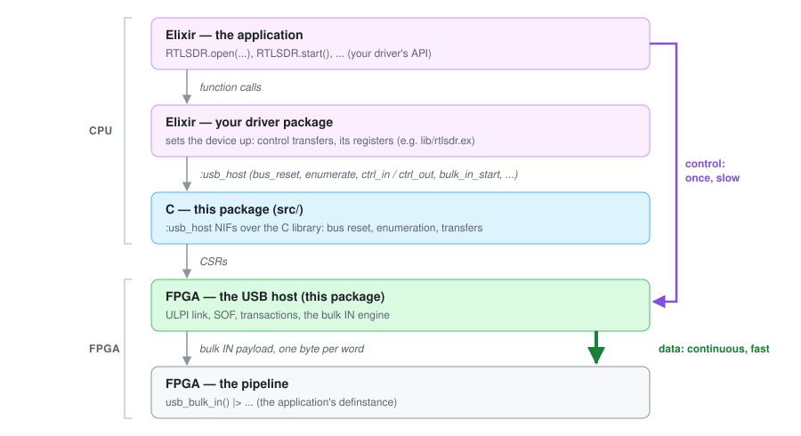

# Writing a device driver on the USB host

English | [日本語](driver-guide.ja.md)

How to drive a USB device from an application built with atomvm-tang25k-hls. The driver is
written in Elixir on this package's `:usb_host` functions, and the device's data stream goes
into an FPGA pipeline without passing through the CPU.
[atomvm-tang25k-rtlsdr](https://github.com/elixir-hls/atomvm-tang25k-rtlsdr) (`RTLSDR`) is a
complete example; this guide follows it.

## How the work is divided



Setting the device up is a sequence of control transfers, slow and done once: the CPU does
it, in the driver's Elixir code. The data stream is fast and continuous: once the driver
starts the bulk IN engine, the FPGA keeps asking the device for data and hands the payload to
the pipeline, one byte per word.

The driver uses this package only through `:usb_host` (lib/usb_host.erl). The C library and
the host's CSRs underneath belong to this package and may change with the hardware.

## A driver package

A driver is a package with Elixir code only:

```
mydev/
  lib/mydev.ex          the driver: MyDev.open/..., built into the application's pack
```

The application names both this package and the driver in its hls.env:

```sh
EHLS_BLOCKS=../atomvm-tang25k-usb-host:../mydev
```

atomvm-tang25k-hls's scripts compile every package's lib/ into the application's pack, and
the `:usb_host` NIFs are in AtomVM when the SoC has the USB host (the application uses
`EHLS.USBHost`).

## The steps

### 1. Bus reset

```elixir
case :usb_host.bus_reset() do
  :ok -> :ok
  {:error, _} ->
    # the PHY sometimes does not answer after power-up: a reset pulse brings it back
    :usb_host.phy_reset()
    :usb_host.bus_reset()
end
```

`bus_reset/0` turns VBUS on, waits for a device, resets the bus with the high-speed handshake
and starts the SOFs.

### 2. Enumeration

```elixir
{:ok, addr, device_descriptor} = :usb_host.enumerate()
```

It reads the descriptors, gives the device an address and configures it, directly or behind a
USB 2.0 hub:

| attached | addresses |
|---|---|
| directly | the device: 1 |
| behind a high-speed hub | the hub: 1, the first high-speed device: 2, the first full / low-speed device: 3 (split transactions through the hub) |

`addr` is the high-speed device's address; the 18 bytes of `device_descriptor` (vendor and
product IDs at bytes 8..11) tell whether it is the device the driver is for. On a failure it
returns `{:error, step}`, the step that failed.

### 3. Setting the device up

Control transfers on endpoint 0, with the 8-byte SETUP packet the device's protocol asks for
(bmRequestType, bRequest, wValue, wIndex, wLength):

```elixir
setup = <<0xC0, 0, wvalue::16-little, windex::16-little, n::16-little>>
{:ok, data} = :usb_host.ctrl_in(addr, setup, n)
:ok = :usb_host.ctrl_out(addr, <<0x40, 0, wvalue::16-little, windex::16-little, byte_size(bytes)::16-little>>, bytes)
```

Both retry NAKs and transmission errors themselves; a transfer that still fails returns
`{:error, {err, stage, pid}}`: the stage (1 SETUP, 2 DATA, 3 STATUS) and the PID of the
failing step. The data stage is at most 256 bytes.

### 4. The data stream

```elixir
:usb_host.bulk_in_start(addr, 1, false)   # endpoint 1, the device starts with DATA0
...
:usb_host.bulk_in_stop()
```

From the start on, the bulk IN engine asks the device for data continuously (after a NAK it
waits a moment), and the pipeline's `usb_bulk_in()` stage gets the payload:

```elixir
definstance iq do
  usb_bulk_in() |> ...
end
```

`:usb_host.bulk_in_stats/0` gives its rolling counters `{packets, naks, errors}`: a packet
count that stands still means the stream stopped.

### 5. When something stops

`:usb_host.debug/0` gives the host's state: the ULPI link, the SOFs, the last transaction, the
PHY's registers (0xFF when the PHY does not answer) and its last RX CMD. Return it to the
application for a log (as `RTLSDR.debug/0` does) and open the device again from step 1.

## Checking a driver without the board

`:usb_host` is called through a module the driver can replace: RTLSDR takes it from its
process dictionary (`:rtlsdr_usb`), so a test puts in a mock module with the same functions
that records the transfers and answers the reads. atomvm-tang25k-rtlsdr's
`test/ref/transfers.sh` runs the driver this way against the C driver it replaced, on the
host, and requires every transfer to be the same.

## Drivers in C

A driver can also be C (NIFs built into AtomVM), on the C library under `:usb_host`:
`usbh_bus_reset` and `usbh_bulk_in_start` / `stop` / `stats` / `usbh_debug` (usbh.h),
`usb_enumerate` (usb_enum.h), `usbh_ctrl_in` / `usbh_ctrl_out` and the single transactions of
`usb_xact` (usb_xfer.h), `ulpi_read` (ulpi.h). Its sources go in the package's src/ (compiled
into AtomVM with every package's src/ on the include path), each file inside
`#if __has_include("usbh_csr.h")` so that it builds into nothing on a SoC without the host.
C is for what Elixir cannot reach yet, such as single transactions on other endpoints.

## What it supports, and what not yet

What the FM radio needs:

- In a pipeline, bulk IN only, from one engine: one data stream from one device. No bulk OUT,
  interrupt or isochronous transfers into or out of a pipeline.
- From Elixir, control transfers on endpoint 0; from C also single transactions.
- One high-speed device, directly or behind a hub, and one full / low-speed device behind the
  hub.

The functions wait until they are done; a bus reset alone takes a few hundred milliseconds (a
200 ms debounce of the attach, 15 ms of reset, 12 ms of recovery, usbh.c). The calling
process waits, and with it the rest of AtomVM.
